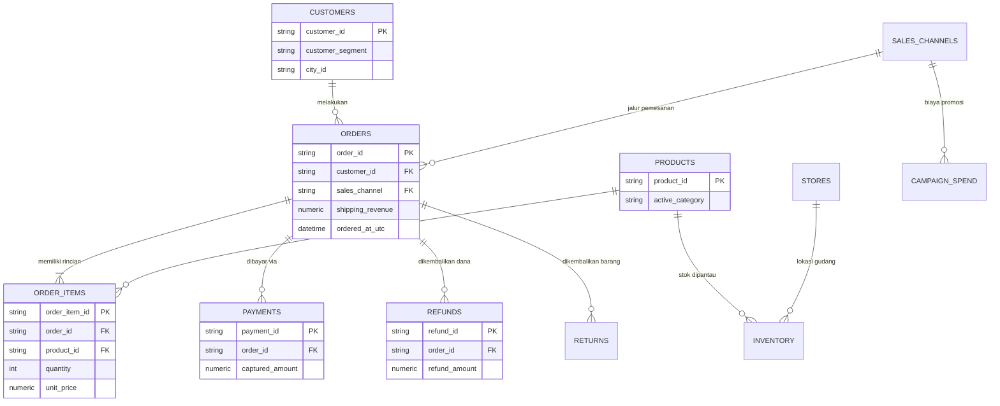

# MATERI PRESENTASI: END-TO-END DATA PIPELINE MILESTONE 1
## Omnichannel Retail NL-to-SQL Analytics
**Presenter:** Bayu Aziz  
**Project:** Milestone 1 — Omnichannel Retail Analytics Platform  

---

## DAFTAR ISI PRESENTASI
1. [Spesifikasi & Konfigurasi Sistem](#1-spesifikasi--konfigurasi-sistem)
2. [Evolusi Struktur Tabel (Medallion Architecture)](#2-evolusi-struktur-tabel-medallion-architecture)
3. [Diagram Relasional & Alur Data](#3-diagram-relasional--alur-data)
4. [Masalah & Anomali Data yang Ditemukan](#4-masalah--anomali-data-yang-ditemukan)
5. [Strategi Penyelesaian Masalah](#5-strategi-penyelesaian-masalah)
6. [Penutup & Dampak Bisnis](#6-penutup--dampak-bisnis)
7. [Ide Pengembangan & Tips Delivery Presentasi](#7-ide-pengembangan--tips-delivery-presentasi)

---

## 1. Spesifikasi & Konfigurasi Sistem

### A. Arsitektur Komputasi & Tech Stack
Pipeline data ini dibangun di atas infrastruktur modern yang modular, reproducible, dan *cloud-native ready*:

| Komponen | Teknologi | Versi | Peran Utama |
|---|---|---|---|
| **Data Storage / Warehouse** | PostgreSQL | 16 | Basis data relasional analitik lokal (Menyimpan Ops, Bronze, Silver, Gold) |
| **Pipeline Orchestrator** | Apache Airflow | 2.9.3 | Otomasi penjadwalan, dependensi DAG, pemantauan *fail-fast*, dan XCom |
| **Airflow Executor** | LocalExecutor | - | Eksekusi paralel task dalam container scheduler |
| **Environment & Package** | UV & Python | 3.12 
| **Database Driver** | pg8000 & psycopg2 | Pure Python
| **AI Analytical Engine** | FastAPI (Uvicorn) | 2.0.0 | API boundary untuk validasi dan eksekusi query NL-to-SQL ke layer Gold |
| **Front-End Dashboard** | Streamlit + Plotly | 1.40+ | Antarmuka obrolan analitik interaktif berbasis grafik dan visualisasi data |
| **Containerization** | Docker & Docker Compose | Compose v2 | Isolasi environment (`postgres`, `webserver`, `scheduler`, `api`, `ui`) |

### B. Konfigurasi Environment (`.env` & `docker-compose.yml`)
- **Target Koneksi:** Diarahkan ke database lokal (`ANALYTICS_DB_TARGET=local`)
- **Port Mapping:**
  - `5432` : PostgreSQL Analytics Server
  - `8080` : Apache Airflow Web UI Dashboard
  - `8000` : FastAPI NL-to-SQL Service
  - `8501` : Streamlit Analytics Chatbot UI
- **Resource Tuning (Windows Docker):**
  - `AIRFLOW__WEBSERVER__WEB_SERVER_MASTER_TIMEOUT: 300` (Mencegah gunicorn worker timeout saat preloading aplikasi).
  - `AIRFLOW__WEBSERVER__WORKERS: 2` (Mengoptimalkan utilisasi RAM laptop).

---

## 2. Evolusi Struktur Tabel (Medallion Architecture)

Transformasi data menerapkan prinsip **Medallion Architecture (Bronze $\rightarrow$ Silver $\rightarrow$ Gold)** ditambah schema **Ops** untuk observabilitas:

```
[ RAW DATA LAKE ] ──► [ BRONZE ] ──► [ SILVER ] ──► [ GOLD ]
(JSON & CSV)          (JSONB Utuh)   (Clean vs Reject) (Fact & Dimensional)
                             │               │
                             ▼               ▼
                     [ OPS.INGESTED ] [ OPS.QUALITY ]
```

### 1. Raw Data Lake (`data/`)
File mentah langsung dari sistem operasional, event stream, dan warehouse inventori:
- **Operational:** `orders.json`, `order_items.json`, `customers.json`, `customer_profiles.json`, `products.json`, `product_categories.json`, `stores.json`, `sales_channels.json`, `promotions.json`, `order_promotions.json`.
- **Events:** `payment_events.json`, `refund_events.json`, `return_events.json`, `support_events.json`, `web_events.json`.
- **Inventory & Reference:** `inventory_snapshots.csv`, `campaign_spend.csv`, `city_reference.json`.

### 2. Bronze Layer (`bronze.raw_records`)
- **Konsep:** *Immutable Source Preservation*.
- **Struktur:** 1 tabel universal fleksibel berisi: `id`, `pipeline_run_id`, `source_category`, `file_name`, `source_row_id`, dan **`payload JSONB`**.
- **Fungsi:** Menyimpan seluruh data asli apa adanya tanpa manipulasi atau join bisnis agar dapat di-audit ulang kapan saja (*replayable*).

### 3. Silver Layer (Normalisasi, Validasi & Pemisahan)
- **Tabel Clean:** `silver.orders`, `silver.order_items`, `silver.payments`, `silver.refunds`, `silver.returns`, `silver.customer_profiles`, `silver.product_categories`, `silver.inventory_snapshots`, `silver.campaign_spend`.
- **Tabel Reject (`silver.rejected_records`):** Menyimpan setiap baris yang gagal aturan integritas bisnis beserta `reject_reason` (misal: quantity bernilai negatif $\le 0$).

### 4. Gold Layer (Analytical Datamart Contract)
Tabel dimensional yang siap dikonsumsi langsung oleh manajemen dan NL-to-SQL Engine:
1. **`gold.order_360`** *(Grain: 1 baris per `order_id`)*: Integrasi pesanan, nilai belanja, diskon, pembayaran captured, refund, dan status retur.
2. **`gold.customer_daily`** *(Grain: `customer_id` + `metric_date`)*: Perilaku pelanggan harian, revenue kontribusi, retur, kontak support, serta status pelanggan baru vs repeat.
3. **`gold.product_daily`** *(Grain: `product_id` + `metric_date`)*: Kinerja penjualan produk, revenue, sisa stok gudang, dan deteksi kehabisan barang (*stockout flag*).
4. **`gold.channel_campaign_daily`** *(Grain: `metric_date` + `sales_channel` + `campaign_id`)*: Efektivitas promosi marketing, biaya iklan harian, attributed revenue, dan metrik **ROAS**.
5. **`gold.executive_kpis_daily`** *(Grain: 1 baris per tanggal bisnis)*: Metrik level pimpinan (Total Order, Net Revenue, AOV, Refund Rate, Return Rate, Repeat Customer Rate, Stockout Rate).

### 5. Ops Layer (Observabilitas & Audit Pipeline)
- **`ops.pipeline_runs`**: Melacak status pipeline (`RUNNING`, `SUCCESS`, `FAILED`), tahapan gagal (`current_stage`), waktu eksekusi, serta jumlah record (read, clean, rejected).
- **`ops.ingested_files`**: Melacak nama file, path, jumlah record, dan checksum SHA-256 untuk memastikan idempotensi.
- **`ops.quality_checks`**: Rekap riwayat pengujian data quality gate sebelum masuk ke Gold.

---

## 3. Diagram Relasional & Alur Data

### A. Diagram Relasional Sederhana (Hubungan Inti Entitas)

Diagram relasional di bawah ini menyederhanakan hubungan antar entitas operasional utama:



### B. Alur Orkestrasi Airflow DAG (`dags/dag.py`)

Alur sekuensial yang menjamin kebersihan dan integritas data di setiap gerbang:

```
[1. initialize_schema]
         │  (Membuat DDL ops, bronze, silver, gold jika belum ada)
         ▼
[2. validate_raw]
         │  (Validasi kelengkapan data lake & mencatat run_id ke ops)
         ▼
[3. load_bronze]
         │  (Ingest JSON/CSV ke payload JSONB + checksum SHA-256)
         ▼
[4. build_silver]
         │  (Normalisasi UTC, deduplikasi, pisahkan clean & rejected)
         ▼
[5. quality_gate] ───► [GAGAL?] ──► STOP PIPELINE & Catat Error ke Ops
         │ (LOLOS)
         ▼
[6. build_gold]
         │  (Transformasi CTE tanpa fan-out ke 5 tabel Gold)
         ▼
[7. validate_gold_and_record_metadata]
            (Verifikasi baris terisi & tandai status pipeline SUCCESS)
```

---

## 4. Masalah & Anomali Data yang Ditemukan

Dataset sengaja dirancang memiliki masalah nyata yang sering dijumpai di dunia kerja produksi:

| No | Kategori Masalah | Contoh Kasus Nyata di Raw Data | Risiko Jika Tidak Ditangani |
|---|---|---|---|
| **1** | **Data Tidak Valid (Negative Quantity)** | Ada baris pada `order_items.json` dengan `quantity = -1` atau `-5`. | Nilai GMV dan revenue bisnis menjadi minus dan merusak perhitungan finansial. |
| **2** | **Format Waktu Beragam (Timezone Inconsistency)** | Pada `payment_events.json`, sebagian timestamp berakhiran `Z` (UTC) dan sebagian offset lokal `+07:00`. | Analisis harian (*daily metrics*) salah tanggal transaksi (misal transaksi malam bergeser ke hari berikutnya). |
| **3** | **Duplikasi Data (Duplicate Orders/Events)** | Satu `order_id` muncul berulang kali di `orders.json` dengan perubahan status dan `updated_at_utc` berbeda. | Penjualan dan jumlah order terhitung ganda (*double counting*). |
| **4** | **Dimensi Berubah Seiring Waktu (SCD Type 2)** | Pelanggan pindah kota/segmen di `customer_profiles.json` dan kategori produk berganti di `product_categories.json`. | Analisis historis menggunakan kategori baru untuk pesanan masa lalu (anakronisme data). |
| **5** | **Perangkap Penggandaan Fakta (Fact Multiplication / Fan-out)** | 1 pesanan memiliki 3 item, 2 split payment, dan 1 refund. Jika di-`JOIN` langsung, menghasilkan 6 baris Cartesian. | GMV dan nilai pembayaran terlipatgandakan secara masif. |
| **6** | **Masalah Dependensi Container Airflow** | `airflow-init` gagal saat menjalankan instalasi pip otomatis karena berjalan sebagai user `root`. | Airflow tidak mau *startup* dan berhenti dengan `exit code 1`. |

---

## 5. Strategi Penyelesaian Masalah

Berikut adalah solusi teknis data engineering yang diimplementasikan:

### 1. Penanganan Nilai Negatif $\rightarrow$ *Tabel Reject Terisolasi*
- Menerapkan filter logika pada `build_silver.py`: data dengan `quantity <= 0` dialihkan ke tabel **`silver.rejected_records`** dengan alasan `INVALID_QUANTITY_NEGATIVE_OR_ZERO`.
- Hanya data dengan `quantity > 0` yang masuk ke `silver.order_items`.

### 2. Penanganan Timezone $\rightarrow$ *UTC Standard Casting*
- Semua input string timestamp diparsing dan dikonversi secara eksplisit ke tipe data PostgreSQL **`TIMESTAMPTZ`** (UTC murni). Perbedaan zona waktu lokal otomatis disetarakan ke UTC.

### 3. Penanganan Duplikasi $\rightarrow$ *Deduplikasi Deterministik*
- Menggunakan Window Function SQL untuk memilih versi transaksi paling mutakhir:
  ```sql
  ROW_NUMBER() OVER (
      PARTITION BY order_id 
      ORDER BY updated_at_utc DESC
  ) = 1
  ```

### 4. Penanganan SCD Type 2 $\rightarrow$ *Point-in-Time Temporal Join*
- Menghubungkan pesanan dengan dimensi menggunakan klausa rentang waktu:
  ```sql
  WHERE ordered_at_utc >= valid_from_utc 
    AND ordered_at_utc < valid_to_utc
  ```

### 5. Pencegahan Fan-Out / Fact Multiplication $\rightarrow$ *CTE Pre-Aggregation*
- Setiap dimensi transaksi diagregasikan terpisah terlebih dahulu sebelum digabungkan ke tabel `orders`:
  - CTE 1: Agregasi item level per `order_id` (GMV, unit, item count).
  - CTE 2: Agregasi payment level per `order_id` (Total captured amount).
  - CTE 3: Agregasi refund level per `order_id` (Total refunded amount).
  - Tahap Akhir: Melakukan `LEFT JOIN 1-to-1` ke tabel order, sehingga **tidak ada baris yang berlipat ganda**.

### 6. Penerapan Quality Gate (*Fail-Fast Principle*)
- Sebelum tahap Gold dieksekusi, task `quality_gate` di Airflow memvalidasi:
  - Jumlah order di Silver harus $> 0$.
  - Tidak boleh ada quantity $\le 0$ di tabel clean.
  - Primary key `order_id` harus 100% unik.
- Jika salah satu aturan gagal, pipeline langsung berhenti (*raise AirflowException*), status ditandai `FAILED` di `ops.pipeline_runs`, dan Gold layer terlindungi dari polusi data.

---

## 6. Penutup & Dampak Bisnis

### A. Key Takeaways
1. **Pemisahan Tanggung Jawab Layer yang Jelas:**
   - **Bronze:** Mempertahankan keaslian bukti data sumber (*source evidence*).
   - **Silver:** Memastikan kualitas data tinggi, konsisten waktu, dan audit jejak data rusak.
   - **Gold:** Menyajikan metrik finansial dan operasional yang siap pakai (*business-ready*).
2. **Keterandalan & Observabilitas Penuh:**
   - Setiap run pipeline tercatat di skema `ops`, memudahkan *troubleshooting*, pelacakan audit, dan deteksi error secara dini.
3. **Kesiapan Konsumsi AI & Eksekutif:**
   - Layer Gold berhasil dihubungkan ke **FastAPI NL-to-SQL Engine** dan **Streamlit UI**, memungkinkan pengguna awam menanyakan kondisi bisnis dalam bahasa alami dan mendapatkan visualisasi data yang akurat.

---

## 7. Ide Pengembangan & Tips Delivery Presentasi

*(Bagian ini dapat dijadikan bahan referensi tambahan saat tanya jawab atau pengembangan slide presentasi):*

### A. Rekomendasi Struktur Slide Presentasi (10 Slide Efektif)
- **Slide 1:** Judul Presentasi & Profil Tim / Data Engineer.
- **Slide 2:** Latar Belakang Masalah Bisnis Ritel Omnichannel (Multi-channel data silo & dirty data lake).
- **Slide 3:** Arsitektur End-to-End Pipeline (Dari Google Drive Data Lake $\rightarrow$ PostgreSQL $\rightarrow$ UI).
- **Slide 4:** Medallion Architecture Breakdown (Bronze, Silver, Gold, Ops).
- **Slide 5:** Data Quality Challenges (Negative Qty, Mixed Timezone, Duplicates, Fan-out).
- **Slide 6:** Solusi Engineering (Clean vs Reject, Deterministic Deduplication, CTE Pre-aggregation).
- **Slide 7:** Airflow DAG Orchestration & Fail-Fast Quality Gate (Tampilkan screenshot DAG hijau).
- **Slide 8:** Gold Layer Analytics (Penjelasan rumus Net Revenue, AOV, ROAS, Refund Rate).

- **Slide 9:** Live Demo / Showcase (Streamlit Chatbot UI & NL-to-SQL query hasil Gold).
- **Slide 10:** Kesimpulan, Business Impact, dan Rencana Future Work.

### B. Ide Pertanyaan Tanya Jawab (Q&A Defense) yang Sering Ditanyakan Penguji:
1. **T: Kenapa memilih format JSONB di Bronze daripada langsung membuat tabel-tabel terpisah?**  
   *Jawab:* Karena JSONB memberikan fleksibilitas skema (*schema evolution*) dan mempertahankan bukti asli (*source evidence*) tanpa perlu migrasi DDL jika struktur raw data berubah sewaktu-waktu.
2. **T: Bagaimana membuktikan bahwa tidak terjadi Fact Multiplication (penggelembungkan data)?**  
   *Jawab:* Dengan melakukan rekonsiliasi antara `SUM(gross_merchandise_value)` di `gold.order_360` dengan total item di `silver.order_items`. Nilainya terbukti sama persis karena agregasi dilakukan di CTE sebelum proses join.
3. **T: Mengapa menggunakan Airflow dan bukan cron job Python biasa?**  
   *Jawab:* Airflow menyediakan manajemen dependensi task (DAG), retry policy, XCom metadata passing, visual monitoring, dan kemampuan *fail-fast quality gate* yang tidak dimiliki oleh cron job script biasa.
